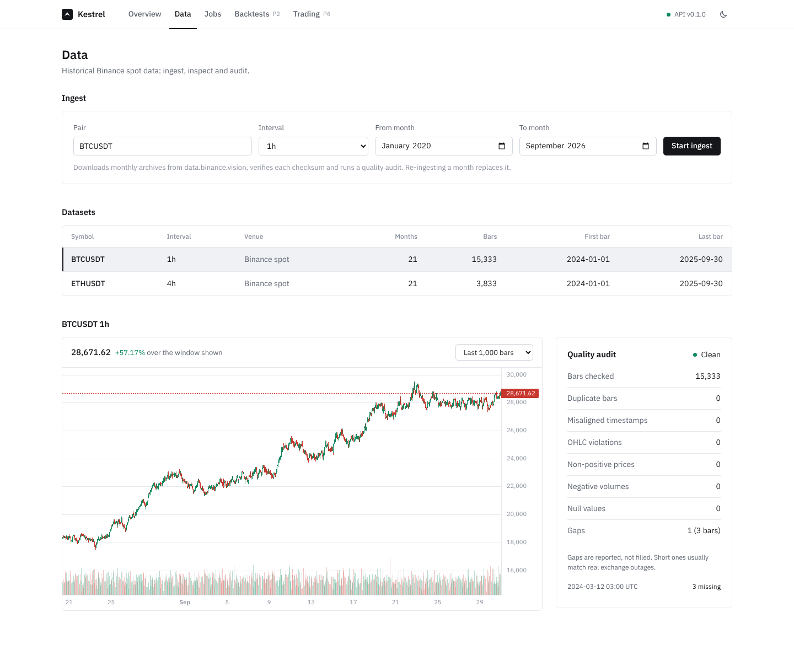

# Kestrel

A research-to-production platform for systematic crypto trading, built so that a
strategy behaves the same way in research, backtest, paper trading and live
trading.

> **Status:** Data, API, dashboard, the backtester (two engines, costs, metrics,
> bootstrap confidence) and validation (walk-forward, robustness, deflated Sharpe over
> every trial) are built and tested. About 25 pre-registered hypotheses have been tested;
> none has passed. See [research/findings.md](research/findings.md). Paper trading is next.
> No strategy has yet earned real money, by design.

## Why this exists

Most retail trading systems fail in the gap between backtest and live: lookahead
bias, unrealistic fills, ignored costs, and research code that is rewritten
(differently) for production. Kestrel is built around closing that gap.

**Design principles**

1. **One strategy code path.** Strategies talk to an `ExecutionVenue` interface,
   never to an exchange. Backtest, paper and live are interchangeable
   implementations, and parity tests fail the build if they disagree.
2. **Data you can trust.** Every source is normalised into one canonical schema,
   checksum-verified, and audited for gaps, duplicates and OHLC integrity before
   use. Problems are reported, never silently patched.
3. **Costs are first-class.** Fees, spread and slippage are modelled from the
   start, not bolted on after a backtest looks good.
4. **Honest research.** Hypotheses are written down before testing, every variant
   tried is logged, and a holdout period is reserved and touched once.

## Roadmap

| Phase | Scope | Status |
|---|---|---|
| 1. Data | Binance bulk ingestion, canonical schema, Parquet store, quality checks | Done |
| 1.5 Platform | FastAPI service, job runner, React dashboard | Done |
| 2. Backtester | Vectorised research engine, event-driven validation engine, cost model, metrics, stops/targets with risk-based sizing | Done |
| 3. Validation | Walk-forward, parameter robustness, trial log, deflated Sharpe | Done |
| Next | One pass/fail scorecard for every strategy, judged against holding at the same exposure | Next |
| 4. Execution | `ExecutionVenue` adapters (sim, Binance testnet, live), reconciliation, kill switch, alerting | Planned |
| Parked | Perps (Binance perps aren't available to Australian retail; ASIC caps retail crypto leverage at 2:1); multi-strategy portfolios; settings for risk limits and exchange status | Parked |

## Quick start

Requires Python 3.11+ and Node 18+.

```bash
python -m venv .venv && source .venv/bin/activate
pip install -e ".[dev]"
(cd frontend && npm install && npm run build)   # builds the dashboard into the package

# Run the platform: dashboard at http://127.0.0.1:8000, API docs at /api/docs
kestrel serve
```

Everything the dashboard does is also available from the CLI:

```bash
# Download, checksum-verify and store hourly BTC/USDT history
kestrel ingest BTCUSDT --interval 1h --start 2020-01

# Audit it
kestrel check BTCUSDT --interval 1h

# Backtest the benchmark (buy-and-hold of the same market) before the holdout period
kestrel backtest BTCUSDT --interval 4h --start 2022-01 --end 2025-10
```

Data lands in `./data` (override with `--data-dir` or `KESTREL_DATA`) as
Hive-partitioned Parquet, queryable directly from polars or DuckDB:

```python
import duckdb

duckdb.sql("""
    SELECT date_trunc('day', open_time) AS day, last(close ORDER BY open_time) AS close
    FROM 'data/klines/venue=binance/symbol=BTCUSDT/interval=1h/*.parquet'
    GROUP BY 1 ORDER BY 1
""")
```

## Dashboard



<sub>Screenshot uses synthetic test data. Light and dark themes; toggle in the top bar.</sub>

One place to run every operation. Long-running work (ingestion now, backtests and
validation runs later) executes as a **job** with live progress, logs and
cancellation, so nothing blocks and every run leaves a record.

| Page | What it does |
|---|---|
| Overview | Platform health, data coverage, active and recent jobs, roadmap |
| Data | Ingest from Binance, browse datasets, candlestick + volume chart, quality audit with gap list |
| Jobs dock | Floating tray on every page: live progress when collapsed; expands to every job with logs and cancel |
| What a trade costs | The live cost model: per-order breakdown, cost vs size, yearly drag by trading frequency, decision log |
| Strategies | Research notes (hypothesis, rationale, rules, falsification, parameters, costs), frozen before testing; read-only code; signals chart; trials run from the note; trial log; a research assistant that never sees results |
| Backtests | Launch runs as jobs; saved runs with return vs BTC, Sharpe CI, drawdown, equity and drawdown charts, costs, fills and provenance |
| Trading | *Phase 4:* positions, live vs backtest drift, risk limits, kill switch |

## Architecture

```
            ┌──────────────────────────┐
            │  React dashboard (Vite)  │   frontend/
            └────────────┬─────────────┘
                         │ HTTP/JSON (OpenAPI at /api/docs)
            ┌────────────▼─────────────┐
            │  FastAPI + JobManager    │   kestrel.api   (thin adapter, no logic)
            └────────────┬─────────────┘
                         │ plain function calls
┌────────────────────────▼─────────────────────────────────────────────┐
│ Engine: kestrel.data (and later kestrel.backtest, kestrel.execution) │
│ never imports the API, so CLI, scripts and tests use it directly     │
└──────────────────────────────────────────────────────────────────────┘
```

The engine has no idea a web server exists. The API is a thin adapter over it and
the dashboard only talks to the API, so each layer can be tested and replaced on
its own.

### Data pipeline

```
data.binance.vision ──► BinanceVisionClient ──► parse_archive ──► ParquetStore ──► check_klines
   (monthly zips)        (download + SHA-256)   (canonical schema)  (month-partitioned,  (gaps, dupes,
                                                 ms/µs normalised)    atomic writes)       OHLC integrity)
```

| Module | Responsibility |
|---|---|
| `kestrel.data.schema` | Canonical kline schema and intervals; the contract every source must meet |
| `kestrel.data.binance_vision` | Download, checksum verification, parsing of Binance bulk archives |
| `kestrel.data.store` | Idempotent, atomic, month-partitioned Parquet storage |
| `kestrel.data.quality` | Integrity audit that reports rather than repairs |
| `kestrel.config` | Strict loader for `kestrel.toml`: no defaults in code, exact decimals, fingerprint per config |
| `kestrel.backtest.costs` | Fee, spread and square-root impact model; simulated market fills with exchange order rules |
| `kestrel.strategy` | Strategy interface (target weights from closed bars) and the automatic lookahead check |
| `kestrel.execution.venue` | `ExecutionVenue` interface and `SimVenue`, the simulated spot account |
| `kestrel.backtest.engine` | Event-driven engine: decide at close, fill at next open, no-trade band, holdout guard; stops and targets inside bars with risk-based sizing |
| `kestrel.backtest.metrics` | Daily-marked metrics with uncertainty: Sharpe CI, probabilistic Sharpe, drawdown, costs |
| `kestrel.strategies` | Research strategies and the plainer controls each must beat; `geometry` holds ATR, swings known without hindsight, and lines through them |
| `kestrel.studies` | Raw-effect studies run before any trading rule, such as the anchor-day range study (`kestrel anchor-study`) |
| `kestrel.validation` | P3: deflated Sharpe (corrected for every strategy tried), walk-forward (`kestrel walk-forward`), parameter robustness (`kestrel robustness`), and the log of every validation study |
| `kestrel.backtest.portfolio` | One strategy holding several coins, with each coin's spread banded by its volume |
| `kestrel.research` | Versioned research notes with enforced pre-registration, and the single rule set for starting a backtest |
| `kestrel.assistant` | Research assistant on Claude, given the note and code only, never results |
| `kestrel.backtest.vectorised` | Second, independent engine in polars columns; a parity test requires it to agree with the event engine |
| `kestrel.backtest.analysis` | Block-bootstrap confidence, break-even cost, BTC beta and exposure-matched BTC, tails, calendar years, FIFO tax view |
| `kestrel.backtest.runs` | Runs a strategy plus the BTC benchmark and saves every run (metrics, config snapshot, code version) |
| `kestrel.api.app` | REST endpoints for datasets, bars, quality and jobs |
| `kestrel.api.jobs` | Thread-pool job runner: progress, logs, cooperative cancellation |
| `kestrel.cli` | `ingest`, `check`, `list`, `serve` commands |
| `frontend/` | React + TypeScript dashboard, typed API client, light/dark theme tokens, TradingView Lightweight Charts |

### Notable details

- **Timestamp units.** Binance spot archives switched from milliseconds to
  microseconds on 2025-01-01. Units are detected per row, and a test asserts that
  the same bars encoded both ways parse to identical frames.
- **Atomic writes.** Each month is written to a temp file and renamed, so a crash
  cannot leave a half-written partition.
- **Offline tests.** HTTP is injected, so the suite runs against byte-compatible
  fixture archives with no network. A `network`-marked test checks the real site.
- **Jobs never fake success.** An ingest that finds nothing to download fails
  with a clear reason instead of reporting success with zero data.
- **Costs, attributed.** Every simulated fill splits its cost into fee, spread and
  market impact. As configured, a round trip in liquid BTC costs about 22 bps, so a
  strategy needs more than that per trade just to break even. Impact is sized from the
  last *closed* bar's volume, so a fill never uses information from its own bar.
- **One cost formula, two engines.** The per-order fill (event-driven engine) and the
  cost rate (vectorised engine) share a formula, and a test asserts they agree.
- **Lookahead is checked, not trusted.** Before a backtest runs, the engine recomputes
  the strategy's weights on truncated histories. A strategy that peeks at a future bar
  gives different answers and is refused.
- **A pre-registered holdout.** Data from 2025-11-01 is reserved for one final test.
  The engine refuses it unless explicitly allowed, and the report flags any run that
  used it.
- **Validated against an independent calculation.** On real BTCUSDT 4h data
  (2022-01 to 2025-10), the engine's buy-and-hold result matches a hand calculation
  from the raw bars to within the 0.00001 BTC quantity rounding.
- **Pre-registration is enforced.** A research strategy can't be backtested until its
  note (hypothesis, why the edge exists, rules, what would prove it wrong, parameters,
  expected costs) is frozen. A frozen note can't be edited, only superseded by a new
  version with a written reason. Notes live in `research/` in the repo, so git history
  independently dates each freeze.
- **Every run is a counted trial.** Runs record the note version and parameters; the
  trial log counts distinct configurations (identical re-runs count once) for P3's
  deflated Sharpe.
- **An AI assistant outside the tuning loop.** The research assistant (Claude) is given
  the note and the code, never backtest results, so it can challenge an idea but can't
  fit it to past data. A test runs a trial and checks nothing from it reaches the API.
- **Two engines that must agree.** A vectorised engine (whole columns, floats, ~6x
  faster) re-implements the event engine's model, including how a position's weight
  drifts between trades. A parity test runs both on the same data and requires daily
  returns to match within 0.01%; planting a timing bug or ignoring drift makes it fail.
- **Stops and targets, measured in R.** Bracket strategies set a stop and a target;
  the engine sizes each trade from the risk per trade and the stop distance (spot, no
  leverage) and exits inside bars from the high and low. When a bar reaches both, the
  stop is assumed first, and a gap through the stop fills at the open. Results, costs
  and expectancy are reported in units of risk.
- **Config is versioned, not a settings page.** `kestrel.toml` has no defaults in
  code and rejects unknown keys. Each run will store the config and its fingerprint,
  so changing a fee never silently changes what an old result meant.

## Development

```bash
kestrel serve --reload                  # API with auto-reload on :8000
cd frontend && npm run dev              # dashboard with hot reload on :5173 (proxies /api)

scripts/check.sh                        # everything below that CI runs; stops at the first failure

ruff check . && ruff format --check .   # lint + format
mypy                                    # strict type-checking
pytest -m "not network"                 # offline suite
pytest -m network                       # live check against data.binance.vision
cd frontend && npm run typecheck        # strict TypeScript
cd frontend && npm test                 # dashboard tests (Vitest, jsdom)
```

CI runs the Python checks on 3.11 to 3.13 and tests, type-checks and builds the
dashboard on every push.

Charts use [TradingView Lightweight Charts](https://github.com/tradingview/lightweight-charts) (Apache 2.0).

## Disclaimer

Personal research project. Nothing here is financial advice.
